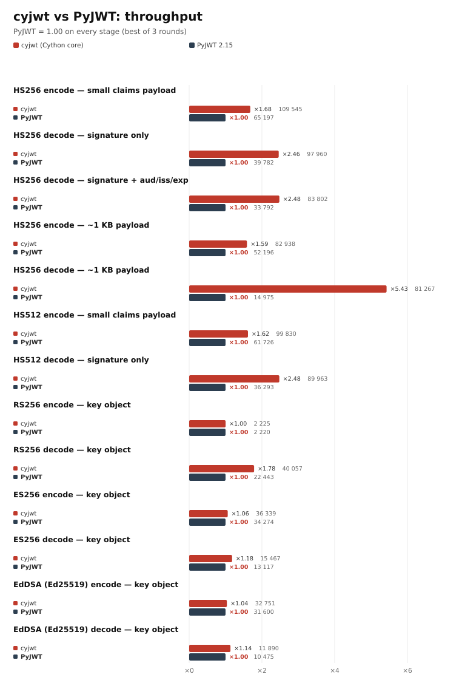

# cyjwt

A fast drop-in replacement for [PyJWT](https://github.com/jpadilla/pyjwt), with a
Cython 3 core. HMAC (`HS256/384/512`) needs nothing beyond the standard library;
the asymmetric algorithms (`RS*`, `PS*`, `ES*`, `EdDSA`) are available through the
optional `cryptography` extra.

The public API mirrors `jwt`: `encode`, `decode`, `decode_complete`,
`get_unverified_header`, `PyJWT`, `PyJWS`, `register_algorithm`,
`unregister_algorithm`, `get_algorithm_by_name`, and the exception hierarchy.
The compatibility target is **PyJWT 2.15.1**; parity is enforced by differential
tests against the installed PyJWT. Requires Python 3.12+, and is tested on
3.12, 3.13, 3.14, and 3.15.

## What is accelerated, and how

The hot byte-level operations live in `_core.pyx`:

| Operation | Implementation |
|---|---|
| base64url encode/decode | table-driven loop, single allocation, no `base64`+`replace`, no extra copy for padding |
| compact JWS splitting | one pass over the token (`header.payload.signature`) |
| signature comparison | constant-time, in C (`ct_equal`) |
| algorithm-confusion guard | fast byte search for PEM/SSH markers and a JWK `kty` member |

On top of that, the Python layer caches the `JSONEncoder` (instead of building one
per `encode`), copies `options` only when needed, copies the payload dict only when
a `datetime` claim must be converted, uses `time.time()` instead of
`datetime.now()`, and passes `bytes`/memoryviews around instead of re-converting.

Everything that carries correctness weight (JSON, HMAC-SHA*, claim validation)
stays on the standard library; asymmetric signatures are delegated to
`cryptography` rather than hand-rolled.

## Benchmarks



Same-session comparison against PyJWT 2.15.1 (one process, best of 3 rounds).
HS256 decode is ~2.5x faster, decode of a ~1 KB token ~5.4x, encode ~1.7x;
asymmetric stages are dominated by `cryptography` (RS256 encode is 1.00x) and
keep a smaller but consistent win on decode. Methodology, full tables and every
stage chart: [docs/benchmarks.md](https://github.com/ivlevdenis/cyjwt/blob/main/docs/benchmarks.md).

Memory footprint (import and steady state, with and without `cryptography`) is
measured by `benchmarks/memory.py`; numbers are in
[docs/benchmarks.md](https://github.com/ivlevdenis/cyjwt/blob/main/docs/benchmarks.md#memory).

Run it yourself:

```bash
python benchmarks/bench.py                              # all stages + charts
python benchmarks/bench.py --stages encode-hs256,decode-hs256
python benchmarks/chart.py                              # re-render from results
python benchmarks/memory.py                             # memory probe
```

Charts are plain SVG generated with the standard library; PNG export needs
`inkscape` and is optional.

## Supported

- `HS256`, `HS384`, `HS512`, `none` (registered, but `verify()` always returns
  `False`, as in PyJWT);
- with `cyjwt[crypto]`: `RS256/384/512`, `PS256/384/512`, `ES256`, `ES256K`,
  `ES384`, `ES512`, `ES521`, and `EdDSA` (Ed25519/Ed448). Keys may be passed as
  `cryptography` key objects, PEM (private/public) or OpenSSH public keys; HMAC
  secrets additionally reject DER/x509 input;
- `exp`, `nbf`, `iat`, `aud` (including `strict_aud`), `iss`, `sub`, `jti`,
  `options["require"]`, `leeway` (number or `timedelta`);
- detached payload (RFC 7797): `headers={"b64": False}` + `crit`;
- `kid` and `crit` header parameters, `sort_headers`, `json_encoder`;
- HMAC key-length checks (`InsecureKeyLengthWarning`,
  `enforce_minimum_key_length`);
- custom `Algorithm` registration (including wrappers over `cryptography`
  for RS*/ES*/PS*/EdDSA).

## Not supported (by design)

`PyJWK`, `PyJWKSet` and `PyJWKClient` (JWKS) are not implemented: raw JWK JSON is
not accepted as a key, and there are no JWK parsing/conversion helpers. Anything
else can still be plugged in as a custom `Algorithm` via `register_algorithm`.

## Installation

```bash
python -m venv .venv && . .venv/bin/activate
pip install "cyjwt[crypto]"      # HMAC + asymmetric algorithms
pip install cyjwt                # HMAC only, zero dependencies
pip install -e ".[dev]"          # development (tests, lint, reference PyJWT)
```

A C compiler is required (gcc/clang or MSVC). Without `cryptography`, `import
cyjwt` still works, `get_default_algorithms()` returns only `HS*`/`none`, and
requesting `RS256` raises `NotImplementedError` with an install hint.

## Usage

Code written against PyJWT works unchanged:

```python
import cyjwt
from cyjwt.exceptions import ExpiredSignatureError

token = cyjwt.encode({"sub": "user", "exp": 4102444800}, "secret-key")
payload = cyjwt.decode(token, "secret-key", algorithms=["HS256"], audience="svc")
header = cyjwt.get_unverified_header(token)
```

Asymmetric algorithms:

```python
token = cyjwt.encode(claims, private_pem, algorithm="RS256")
claims = cyjwt.decode(token, public_pem, algorithms=["RS256"])

token = cyjwt.encode(claims, ec_private_pem, algorithm="ES256")
claims = cyjwt.decode(token, ec_public_pem, algorithms=["ES256"])
```

### Performance note: pass key objects for asymmetric algorithms

`prepare_key` parses PEM on every `encode`/`decode`. For RSA **private** keys
that parse runs OpenSSL key validation, which costs milliseconds rather than
microseconds (measured on this machine with `cryptography` 50: 25 ms at 2048
bits, 78 ms at 3072, 180 ms at 4096). The signature itself is 0.4/1.3/2.9 ms
respectively, so parsing dominates `encode` by ~60x. Pass an already-loaded
`cryptography` key object to avoid it:

```python
from cryptography.hazmat.primitives.serialization import load_pem_private_key

key = load_pem_private_key(pem, password=None)  # once, at startup
token = cyjwt.encode(claims, key, algorithm="RS256")  # 417 us instead of 25.8 ms
```

Public PEM keys parse in ~7-9 us, so `decode` is less affected: at 2048 bits it
takes 35 us with PEM and 28 us with a key object.

Custom algorithm:

```python
from cyjwt import PyJWS
from cyjwt.algorithms import Algorithm


class MyAlg(Algorithm):
    def prepare_key(self, key):
        return key

    def sign(self, msg, key): ...

    def verify(self, msg, key, sig): ...


jws = PyJWS()
jws.register_algorithm("MYALG", MyAlg())
```

## Security

- `algorithms` is required when `verify_signature=True`; the token's `alg` never
  selects the algorithm on its own (RFC 8725 §2.1).
- base64url is decoded strictly and canonically: stray characters, bad padding and
  non-zero trailing bits raise `DecodeError` instead of decoding "somehow".
- An HMAC secret cannot be a PEM/SSH key or raw JWK JSON (`InvalidKeyError`) —
  the algorithm-confusion defence.
- Signature comparison is constant-time.
- Short HMAC keys emit `InsecureKeyLengthWarning` (RFC 7518 §3.2); the
  `enforce_minimum_key_length=True` option turns that into `InvalidKeyError`.
  RSA keys below 2048 bits warn the same way (NIST SP 800-131A).
- EC algorithms pin the expected curve (`ES256` only accepts P-256, `ES256K`
  only secp256k1, and so on); a mismatched curve raises `InvalidKeyError`.
- ECDSA signatures are converted between JOSE `r || s` and DER with the fixed
  width implied by the curve; a wrong-length signature is rejected.
- `b64=false` without `crit: ["b64"]`, and a non-empty payload segment when
  `b64=false`, are rejected.

Deviation from PyJWT 2.15: `PyJWT(options={"verify_signature": False})` actually
disables signature verification in `decode` here (in PyJWT 2.15.1 that
instance-level option is ignored by `decode`, which only looks at the `options`
argument of the call).

## Layout

```
cyjwt/
├── pyproject.toml
├── setup.py                # Extension + cythonize only
├── MANIFEST.in
├── .gitignore
├── LICENSE
├── README.md
├── src/cyjwt/
│   ├── __init__.py         # public API
│   ├── _core.pyx           # base64url, JWS split, HMAC, key-shape checks
│   ├── _core.pxd           # cdef declarations for cimport
│   ├── _core.pyi           # type stubs
│   ├── algorithms.py       # Algorithm, HMAC/None, RSA, PSS, EC, EdDSA
│   ├── _crypto_backend.py  # optional cryptography imports + ECDSA conversion
│   ├── api_jws.py          # PyJWS: signing/verification, headers, crit, detached
│   ├── api_jwt.py          # PyJWT: claims, options, leeway
│   ├── exceptions.py
│   ├── warnings.py
│   ├── _version.py
│   └── py.typed
├── tests/
│   ├── test_core.py
│   ├── test_jws.py         # RFC 7515 and jwt.io vectors
│   ├── test_jwt.py
│   ├── test_asymmetric.py    # RS/PS/ES/EdDSA (skipped without crypto)
│   ├── test_compat_pyjwt.py  # differential HS* tests (require the dev extra)
│   └── test_compat_asymmetric.py  # differential RS/ES/PS/EdDSA tests
├── benchmarks/
│   ├── bench.py            # stage runner: cyjwt vs PyJWT, writes results/*.json
│   ├── chart.py            # SVG/PNG chart renderer (standard library + inkscape)
│   └── memory.py           # import / steady-state memory probe
└── docs/
    ├── benchmarks.md       # methodology, tables, chart index
    └── img/charts/         # generated stage and combined charts
```

## Development

```bash
pytest                       # 200 tests, differential ones included
pytest --cov=cyjwt
mypy                         # strict
ruff check . && ruff format --check .
python benchmarks/bench.py   # cyjwt vs PyJWT + charts (docs/img/charts)
```

The differential tests require `pyjwt==2.15.1` and `cryptography` (both part of
`.[dev]`) and are skipped without them. Rebuild the extension with
`pip install -e . --no-build-isolation --force-reinstall`.

## Building distributions

```bash
python -m build
```

The generated `src/cyjwt/_core.c` is not committed: it goes into the sdist
(building without Cython) but not into the wheel.
