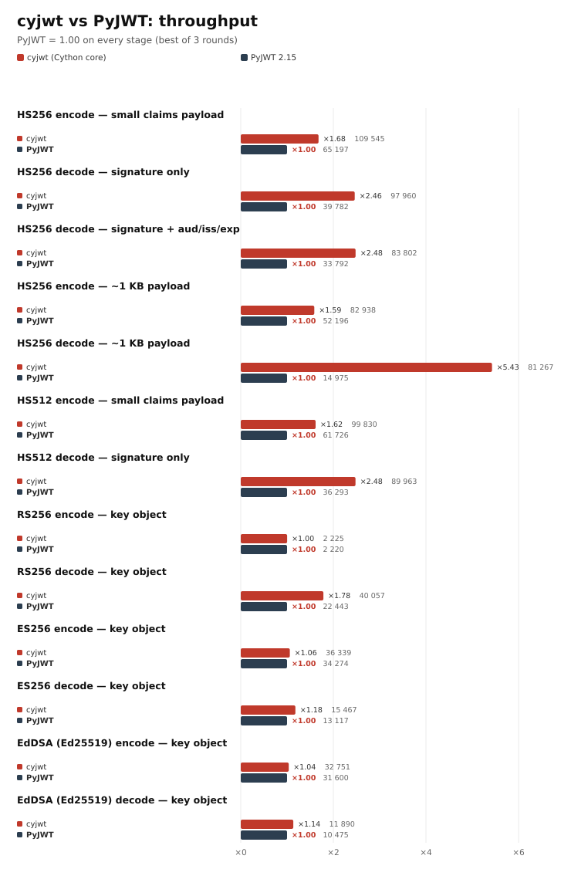

# Benchmarks

`cyjwt` is a drop-in replacement for [PyJWT](https://github.com/jpadilla/pyjwt),
so every number below is a same-session comparison against PyJWT 2.15.1 running
the identical call on the identical token. PyJWT is the `1.00` baseline on all
charts; bars show cyjwt's ratio to it, then the absolute throughput.



## Method

- **Timing:** `timeit.Timer.autorange()` calibrates the iteration count for
  every series, then 3 rounds are taken with the series order alternated
  (cyjwt → PyJWT, then PyJWT → cyjwt) to spread machine drift. The best round
  wins. One process, no concurrency; numbers are throughput per call, not
  end-to-end HTTP.
- **Tokens** are created once per stage, outside the timed loop; encode and
  decode are timed separately.
- **Asymmetric stages use already-loaded `cryptography` key objects.** PEM
  parsing is excluded on purpose: `load_pem_private_key` validates the key
  (primality checks for RSA) and costs milliseconds per call, which would
  swamp everything else. See the [key parsing](#key-parsing-is-not-timed) note.
- **Claims:** `decode-hs256-claims` also validates `aud`, `iss` and `exp`;
  the other decode stages pass only the algorithm allow-list.
- **Payload sizes:** `small` is 4 claims (~90 bytes of JSON), `1k` adds a
  1024-character string field.
- Results are written to `benchmarks/results/stage-<name>.json` (gitignored);
  charts are regenerated from them and committed under `docs/img/charts/`.

## Environment

| Parameter | Value |
|---|---|
| Python | 3.13.0 |
| cyjwt | 0.2.0 (Cython 3.3.1) |
| PyJWT | 2.15.1 |
| cryptography | 50.0.2 |
| OS / CPU | Ubuntu 26.04 LTS, kernel 7.0.0, x86_64 |

## Results (op/s, higher is better)

| Stage | cyjwt | PyJWT | Speedup |
|---|---:|---:|---:|
| `encode-hs256` | 109,545 | 65,197 | **1.68×** |
| `decode-hs256` | 97,960 | 39,782 | **2.46×** |
| `decode-hs256-claims` | 83,802 | 33,792 | **2.48×** |
| `encode-hs256-1k` | 82,938 | 52,196 | **1.59×** |
| `decode-hs256-1k` | 81,267 | 14,975 | **5.43×** |
| `encode-hs512` | 99,830 | 61,726 | **1.62×** |
| `decode-hs512` | 89,963 | 36,293 | **2.48×** |
| `encode-rs256` | 2,225 | 2,220 | **1.00×** |
| `decode-rs256` | 40,057 | 22,443 | **1.78×** |
| `encode-es256` | 36,339 | 34,274 | **1.06×** |
| `decode-es256` | 15,467 | 13,117 | **1.18×** |
| `encode-eddsa` | 32,751 | 31,600 | **1.04×** |
| `decode-eddsa` | 11,890 | 10,475 | **1.14×** |

## Where the difference comes from

- **HS decode, small payload (2.48×):** the Cython core decodes and validates
  base64url in one C loop, splits the compact token in one pass, and compares
  the HMAC in constant time without Python objects. PyJWT additionally runs a
  per-character Python loop over every base64url segment.
- **HS decode, ~1 KB payload (5.43×):** that per-character loop is O(payload
  length) in Python, while ours stays in C — the gap grows with the token.
- **HS encode (1.6–1.7×):** base64url encoding is table-driven in C, and the
  payload encoder is a cached `json.JSONEncoder` instance; JSON serialization
  itself remains stdlib.
- **RS256 encode (1.00×):** the RSA operation (~400 µs at 2048 bits) dominates
  and is identical in both libraries; only Python-layer overhead differs.
- **ES256 / EdDSA (1.04–1.18×):** the signature/verification cost is
  `cryptography`'s, so the gain is limited to token parsing and JSON.
- **RS256 decode (1.78×):** verification is ~21 µs, so the fixed Python-layer
  savings are visible.

## Key parsing is not timed

`prepare_key` parses PEM on every `encode`/`decode` when a PEM string is
passed. For RSA **private** keys that parse runs OpenSSL key validation and
costs milliseconds, not microseconds (measured on this host with
`cryptography` 50):

| Key size | `load_pem_private_key` per call | `prepare_key(key object)` |
|---|---:|---:|
| 2048 | 24.9 ms | 0.50 µs |
| 3072 | 78.0 ms | 0.52 µs |
| 4096 | 179.7 ms | 0.50 µs |

With a PEM string, `encode` is ~25.8 ms at 2048 bits instead of 417 µs
(61× slower) — for both cyjwt and PyJWT. Load the key once at startup and pass
the `cryptography` object; public PEM keys parse in 7–9 µs, so `decode` is much
less affected.

## Memory

Measured by `benchmarks/memory.py`: every case runs in a fresh subprocess, so
imports of the probe itself do not leak into the numbers. PSS and RSS come from
`/proc/self/smaps_rollup` (PSS counts shared pages once), `n = 50,000`
decode/encode calls per case, minimum over 3 repeats, and the Python heap peak
is `tracemalloc`'s peak during the loop.

Both libraries import `cryptography` eagerly when it is installed, so the
tables are split by environment; compare rows within a table, not across
sessions.

### With `cryptography` installed

| Variant | Mode | Import ΔPSS | Import ΔRSS | Steady-state ΔPSS | Peak RSS over baseline | Python heap peak |
|---|---|---:|---:|---:|---:|---:|
| `cyjwt` | decode | 13 141 KB | 16 928 KB | 7 KB | 16 928 KB | 11 KB |
| `cyjwt` | encode | 13 132 KB | 16 852 KB | 0 KB | 16 852 KB | 1 KB |
| `pyjwt` | decode | 15 700 KB | 19 688 KB | 24 KB | 19 712 KB | 35 KB |
| `pyjwt` | encode | 15 706 KB | 19 688 KB | 8 KB | 19 696 KB | 16 KB |

### Without `cryptography` (HMAC only)

| Variant | Mode | Import ΔPSS | Import ΔRSS | Steady-state ΔPSS | Peak RSS over baseline | Python heap peak |
|---|---|---:|---:|---:|---:|---:|
| `cyjwt` | decode | 1 709 KB | 5 320 KB | 16 KB | 5 344 KB | 11 KB |
| `cyjwt` | encode | 1 709 KB | 5 320 KB | 4 KB | 5 324 KB | 1 KB |
| `pyjwt` | decode | 5 228 KB | 9 096 KB | 60 KB | 9 160 KB | 33 KB |
| `pyjwt` | encode | 5 229 KB | 9 088 KB | 16 KB | 9 108 KB | 21 KB |

What the numbers say:

- With `cryptography` installed, it dominates the import footprint in both
  cases (~12-13 MB of the deltas); cyjwt still lands ~2.5 MB lower in PSS and
  ~2.8 MB lower in RSS.
- Without it, cyjwt's import is **3.0x lighter in PSS** and **1.7x lighter in
  RSS**: fewer Python modules and no per-module dicts, just one mapped `.so`.
- Steady state is flat for both (tens of KB, allocator slack): no per-call
  retention or leak over 50k operations.
- Transient Python heap per operation is ~3x lower for cyjwt (11 KB vs 35 KB on
  decode, 1 KB vs 16 KB on encode) because more of the work happens in C.

On disk, an uncompressed cyjwt wheel is 629 KB (553 KB of it is `_core*.so`),
PyJWT is 244 KB of pure Python, and `cryptography` adds 15.5 MB when installed.

```bash
python benchmarks/memory.py                 # current environment
python benchmarks/memory.py --markdown      # tables for this document
python benchmarks/memory.py --no-workload   # import footprint only
# second table: run against a venv without cryptography
python benchmarks/memory.py --python /path/to/venv/bin/python --markdown
```

## Charts

| Stage | SVG |
|---|---|
| combined | [bench-cyjwt-vs-pyjwt.svg](img/charts/bench-cyjwt-vs-pyjwt.svg) |
| `encode-hs256` | [stage-encode-hs256.svg](img/charts/stage-encode-hs256.svg) |
| `decode-hs256` | [stage-decode-hs256.svg](img/charts/stage-decode-hs256.svg) |
| `decode-hs256-claims` | [stage-decode-hs256-claims.svg](img/charts/stage-decode-hs256-claims.svg) |
| `encode-hs256-1k` | [stage-encode-hs256-1k.svg](img/charts/stage-encode-hs256-1k.svg) |
| `decode-hs256-1k` | [stage-decode-hs256-1k.svg](img/charts/stage-decode-hs256-1k.svg) |
| `encode-hs512` | [stage-encode-hs512.svg](img/charts/stage-encode-hs512.svg) |
| `decode-hs512` | [stage-decode-hs512.svg](img/charts/stage-decode-hs512.svg) |
| `encode-rs256` | [stage-encode-rs256.svg](img/charts/stage-encode-rs256.svg) |
| `decode-rs256` | [stage-decode-rs256.svg](img/charts/stage-decode-rs256.svg) |
| `encode-es256` | [stage-encode-es256.svg](img/charts/stage-encode-es256.svg) |
| `decode-es256` | [stage-decode-es256.svg](img/charts/stage-decode-es256.svg) |
| `encode-eddsa` | [stage-encode-eddsa.svg](img/charts/stage-encode-eddsa.svg) |
| `decode-eddsa` | [stage-decode-eddsa.svg](img/charts/stage-decode-eddsa.svg) |

PNG exports (192 dpi) live next to the SVGs when `inkscape` is installed.

## Reproduce

```bash
pip install -e ".[dev]"
python benchmarks/bench.py            # all stages + charts
python benchmarks/bench.py --stages encode-hs256,decode-hs256
python benchmarks/bench.py --rounds 5 --no-charts
python benchmarks/chart.py            # re-render charts from results JSON
python benchmarks/chart.py --check    # layout check into a temp dir
```

`benchmarks/chart.py` uses only the standard library for SVG and shells out to
`inkscape` only for the optional PNG export. Results are not committed; the
charts are.
